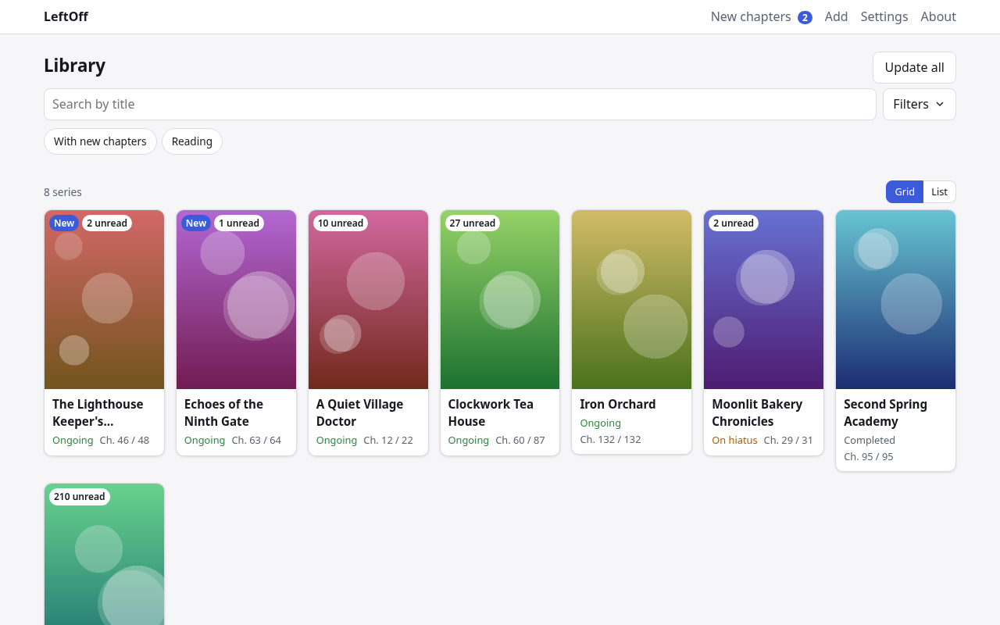
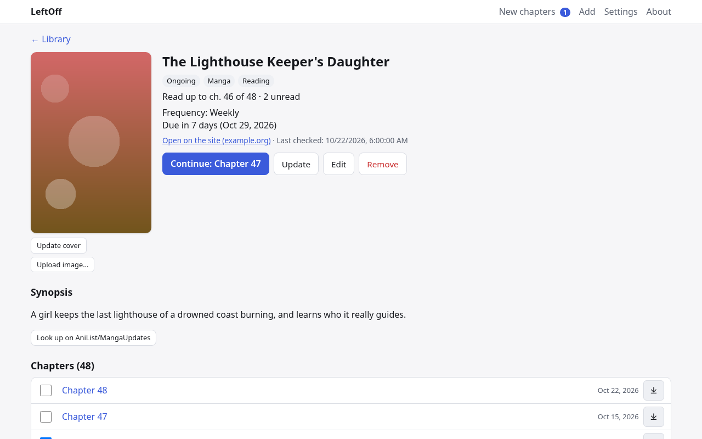
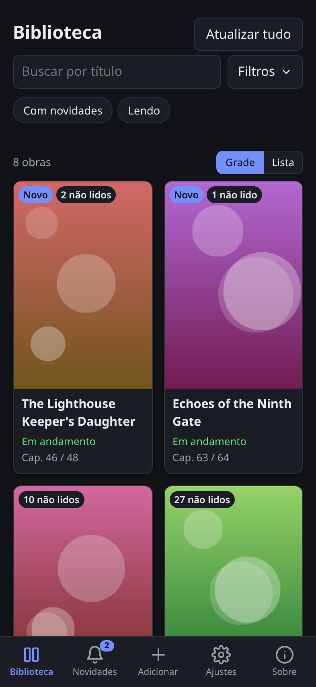
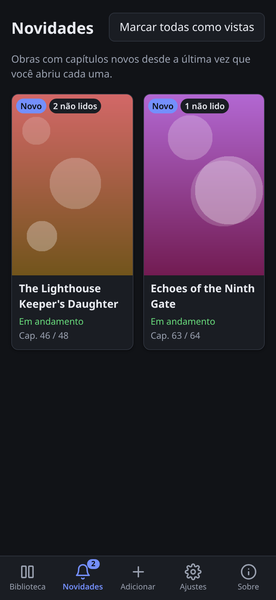

# LeftOff (Onde Parei)

**English** · [Português](#português)

**A reading tracker for manga, manhwa, manhua and novels.** LeftOff keeps the series you follow and the last chapter you read, and tells you when a new one is out. It is not a reader and stores no chapters: a chapter always opens where you read it.

- MangaDex support through its official API
- Your own **recipes** teach it to read other sites, optionally written by a local AI model
- Desktop app with a tray icon, Android app and a home server (Docker / TrueNAS)
- Your library stays with you, in plain JSON files
- Interface in English and Portuguese

<p align="center">
  
</p>
<p align="center">
  
  
  
</p>
<p align="center"><sub>Demo library with made-up series and covers.</sub></p>

## Download (version 0.1.0)

| Platform | Files |
|---|---|
| 🐧 **Linux** | [Desktop app](https://github.com/felipaocosta/leftoff/releases/download/v0.1.0/leftoff-desktop-v0.1.0-linux-amd64) (needs WebKitGTK 4.1) · [Flatpak](https://github.com/felipaocosta/leftoff/releases/download/v0.1.0/leftoff-v0.1.0.flatpak) · [AppImage](https://github.com/felipaocosta/leftoff/releases/download/v0.1.0/LeftOff-v0.1.0-x86_64.AppImage) (opens in your browser) |
| 🪟 **Windows** | [Installer](https://github.com/felipaocosta/leftoff/releases/download/v0.1.0/leftoff-desktop-v0.1.0-windows-setup.exe) · [Desktop app](https://github.com/felipaocosta/leftoff/releases/download/v0.1.0/leftoff-desktop-v0.1.0-windows-amd64.exe) · [Portable](https://github.com/felipaocosta/leftoff/releases/download/v0.1.0/leftoff-v0.1.0-windows-amd64.exe) (opens in your browser) |
| 🤖 **Android** | [APK](https://github.com/felipaocosta/leftoff/releases/download/v0.1.0/leftoff-v0.1.0.apk) |
| 🖥️ **Server** | `docker run -p 8080:8080 -v leftoff:/data ghcr.io/felipaocosta/leftoff:v0.1.0` |

Checksums: [SHA256SUMS](https://github.com/felipaocosta/leftoff/releases/download/v0.1.0/SHA256SUMS) · All versions: [Releases](https://github.com/felipaocosta/leftoff/releases). The Windows files are not signed yet, so SmartScreen may warn on the first run (*More info* → *Run anyway*).

## Quick tour

### 1. Add a series
Click **+ Add**, paste the link of a series page (for example a MangaDex title) and press **Fetch**. Check the preview (title, cover, type, chapters) and press **Save to library**. On Android you can also *Share* a link from your browser to LeftOff.

### 2. Mark what you read
Open a series and tick a chapter, or use **Mark up to here** to mark everything up to it. On a phone, swipe a chapter sideways. **Continue** opens the next unread chapter on the site.

### 3. Get new chapters
LeftOff checks your series every 6 hours, also from the tray with the window closed. Series with new chapters show up in **New chapters**; **Update** refreshes one series and **Update all** the whole library. Optional alerts go to ntfy, Discord or Telegram (*Settings → Notifications*).

### 4. Find things
Search by title, use the **Filters** (new chapters, status, category, type, site) and switch between **Grid** and **List**.

### 5. Teach it a new site
*Settings → Recipes*: a recipe tells LeftOff where the title and the chapter list are on a site. Write one by hand, or press **Generate with AI** with a local model (Ollama or LM Studio). A generated recipe is tested and only used after you save it.

### 6. Keep a backup
*Settings →* **Export library** saves everything to a JSON file; **Import file…** merges it back, keeping every chapter you read.

## Home server (Docker / TrueNAS)

```yaml
services:
  leftoff:
    image: ghcr.io/felipaocosta/leftoff:v0.1.0
    ports: ["8080:8080"]
    volumes: ["./data:/data"]
    environment:
      CHECK_INTERVAL_HOURS: "6"
      AUTH_TOKEN: "change-me"   # optional
```

Open `http://<server>:8080` on any device; on a phone, *Add to home screen*.

## Build from source

Go 1.26+ and Node 24+:

```sh
(cd web && npm ci && npm run build)
go build -o leftoff ./cmd/server && ./leftoff
```

## License

Free software under the [GPL-3.0-or-later](LICENSE). Made by FCR with the help of Claude Opus 5.5.

---

## Português

[English](#leftoff-onde-parei) · **Português**

**Um rastreador de leitura de mangás, manhwas, manhuas e novels.** O LeftOff (Onde Parei) guarda as obras que você segue e o último capítulo que você leu, e avisa quando sai um capítulo novo. Ele não é um leitor e não guarda capítulos: o capítulo sempre abre onde você o lê.

- Suporte ao MangaDex pela API oficial
- **Receitas** suas ensinam o app a ler outros sites, com ajuda opcional de um modelo de IA local
- App de desktop com ícone na bandeja, app Android e servidor em casa (Docker / TrueNAS)
- A sua biblioteca fica com você, em arquivos JSON comuns
- Interface em português e em inglês

<p align="center">
  
  
</p>
<p align="center"><sub>Biblioteca de demonstração, com obras e capas inventadas. Mais capturas na seção em inglês.</sub></p>

## Download (versão 0.1.0)

| Plataforma | Arquivos |
|---|---|
| 🐧 **Linux** | [App de desktop](https://github.com/felipaocosta/leftoff/releases/download/v0.1.0/leftoff-desktop-v0.1.0-linux-amd64) (precisa do WebKitGTK 4.1) · [Flatpak](https://github.com/felipaocosta/leftoff/releases/download/v0.1.0/leftoff-v0.1.0.flatpak) · [AppImage](https://github.com/felipaocosta/leftoff/releases/download/v0.1.0/LeftOff-v0.1.0-x86_64.AppImage) (abre no navegador) |
| 🪟 **Windows** | [Instalador](https://github.com/felipaocosta/leftoff/releases/download/v0.1.0/leftoff-desktop-v0.1.0-windows-setup.exe) · [App de desktop](https://github.com/felipaocosta/leftoff/releases/download/v0.1.0/leftoff-desktop-v0.1.0-windows-amd64.exe) · [Portátil](https://github.com/felipaocosta/leftoff/releases/download/v0.1.0/leftoff-v0.1.0-windows-amd64.exe) (abre no navegador) |
| 🤖 **Android** | [APK](https://github.com/felipaocosta/leftoff/releases/download/v0.1.0/leftoff-v0.1.0.apk) |
| 🖥️ **Servidor** | `docker run -p 8080:8080 -v leftoff:/data ghcr.io/felipaocosta/leftoff:v0.1.0` |

Somas de verificação: [SHA256SUMS](https://github.com/felipaocosta/leftoff/releases/download/v0.1.0/SHA256SUMS) · Todas as versões: [Releases](https://github.com/felipaocosta/leftoff/releases). Os arquivos do Windows ainda não são assinados, então o SmartScreen pode avisar na primeira vez (*Mais informações* → *Executar assim mesmo*).

## Tutorial rápido

### 1. Adicionar uma obra
Clique em **+ Adicionar**, cole o link da página de uma obra (por exemplo, um título do MangaDex) e toque em **Buscar**. Confira o preview (título, capa, tipo, capítulos) e toque em **Salvar na biblioteca**. No Android, você também pode *Compartilhar* um link do navegador com o LeftOff.

### 2. Marcar o que leu
Abra uma obra e marque um capítulo, ou use **Marcar até aqui** para marcar tudo até ele. No celular, deslize o capítulo para o lado. **Continuar** abre no site o próximo capítulo não lido.

### 3. Receber capítulos novos
O LeftOff confere as suas obras a cada 6 horas, também pela bandeja, com a janela fechada. As obras com capítulo novo aparecem em **Novidades**; **Atualizar** confere uma obra e **Atualizar tudo**, a biblioteca inteira. Avisos opcionais vão para o ntfy, o Discord ou o Telegram (*Configurações → Notificações*).

### 4. Encontrar o que procura
Busque pelo título, use os **Filtros** (com novidades, status, categoria, tipo, site) e alterne entre **Grade** e **Lista**.

### 5. Ensinar um site novo
*Configurações → Receitas*: uma receita diz ao LeftOff onde ficam o título e a lista de capítulos num site. Escreva uma à mão ou toque em **Gerar com IA** com um modelo local (Ollama ou LM Studio). A receita gerada é testada e só passa a valer depois que você salva.

### 6. Fazer backup
*Configurações →* **Exportar biblioteca** salva tudo num arquivo JSON; **Importar arquivo…** junta de volta, mantendo todos os capítulos que você leu.

## Servidor em casa (Docker / TrueNAS)

Use o mesmo `compose` da seção em inglês acima e abra `http://<servidor>:8080` em qualquer aparelho; no celular, *Adicionar à tela inicial*.

## Compilar do código

Go 1.26+ e Node 24+: os mesmos comandos da seção em inglês acima.

## Licença

Software livre, sob a [GPL-3.0 ou posterior](LICENSE). Feito por FCR, com o auxílio do Claude Opus 5.5.
